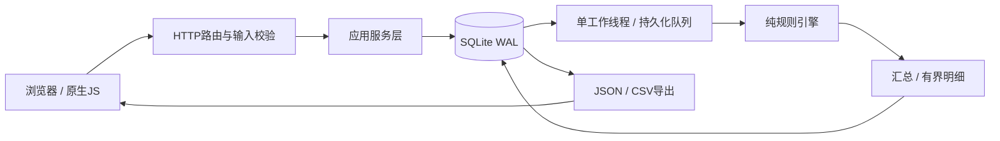
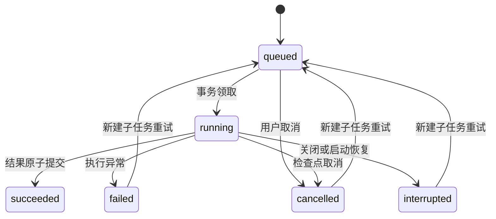

# 架构与关键设计

## 数据模型

- `datasets`：内容哈希唯一、列名、行数据、行数、字节数。原始单元格保留，评估时才做trim。上传文件不按用户路径落盘。
- `rulesets`：当前规则与版本。编辑必须带上读取到的版本号，防止静默覆盖。
- `jobs`：数据集、规则集名字/版本、规则JSON、参考值JSON、规则指纹、状态、进度、时间、父任务、幂等请求键。
- `issues`：任务、逻辑行号、规则ID、列名、严重级别、原值和原因。索引支持任务分页与按规则定位。
- `events`：每次任务状态变化的事件记录。

所有用户值经参数化SQL绑定，路由中的动态SQL仅拼接代码内固定查询片段。

## 任务状态

图中重试箭头表示创建新ID的子任务；原记录不会改写。排队和运行状态都不等于已有可发布的质量结果。

## 一致性

1. 上传校验后，以文件原字节SHA256去重；格式不同但语义相同的CSV不保证去重。
2. 入队使用`BEGIN IMMEDIATE`，同一事务读取数据集、规则版本、参考数据并冻结快照，写入任务。幂等键相同且请求资源相同则返回原任务；冲突返回409。
3. 工作线程在写事务中领取最早任务，状态变为running。不同阶段使用短连接，不跨线程共享SQLite连接。
4. 引擎计算完整汇总，仅保存有界明细。每128个规则/行组合调用轻量检查点，立即检查服务关闭；SQLite取消查询及进度写入按50ms节流，避免每个回调都重新连接数据库。末次检查点及提交事务仍强制检查取消。50ms是轮询间隔，不是实时取消时延保证。
5. 任务结束时在单个事务中写明细、汇总和succeeded状态；事务内再次检查取消，防止取消和提交的竞争发布。
6. 启动时将残留running标记为interrupted，保留queued；操作系统文件锁保证同一数据目录不被两个CLI进程同时恢复。

## 统计定义

每条规则对每行返回通过、失败或跳过。必填规则对空值失败，其余类型遇空值跳过；跨字段比较遇任一字段为空也跳过。唯一性先统计trim后的非空值，重复值的全部出现位置都失败。

- `failed`：所有规则失败次数，可能大于数据行数。
- `bad_rows`：至少命中一次错误或警告的去重行数。
- `evaluated`：passed + failed。
- `score`：passed / evaluated × 100；若无已评估项则为null，而非100。
- `blocked`：存在error；`review`：只有warning；`passed`：均无。
- 有界详情按规则配置顺序收集；超过上限后仍统计全量。分页针对保留明细，不是全量命中的任意分页。

## 局限与升级路线

SQLite保存JSON行数据，因此导入与执行会完整读入内存。4 MiB/20,000行是容量边界，不是吞吐承诺。当前ThreadingHTTPServer仅面向本机个人演示，不承担生产级连接治理。

若升级：先增加契约测试，将HTTP层换FastAPI；再按实际需求引入PostgreSQL、独立进程队列、认证和配额；最后实现分块存储、增量规则和可观测性。不要为了简历罗列尚未实现的组件。
